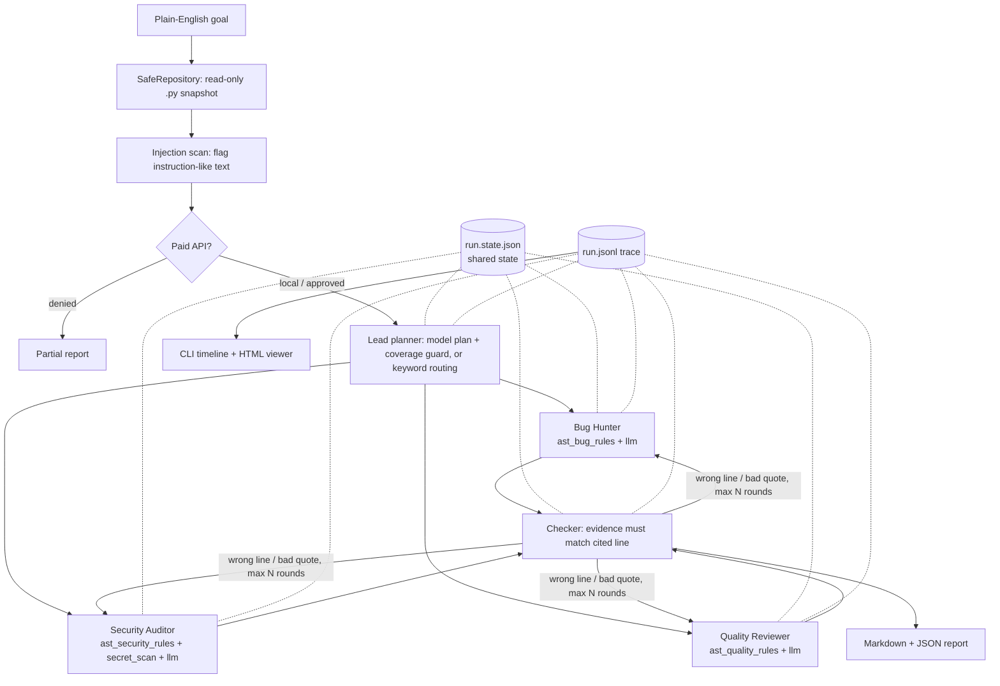

# RepoGuard AI

A multi-agent harness that reviews a Python repository and produces a prioritised, evidence-backed list of issues. A **lead agent** turns a plain-English goal into subtasks, **three specialists** (bug hunter, security auditor, quality reviewer) work in parallel with different tools, a **checker** verifies every cited line against the repository and sends bad work back, and the harness assembles a report with a full trace you can replay.

The harness is the point: roles, tool gates, budgets, retries, partial results, approvals, untrusted-input handling, shared state, and logs. It runs fully offline by default (deterministic rules, no key needed) and with a **free local model via Ollama** or any OpenAI-compatible API.

## Demo video

Due to time constraints I wasn't able to record the demo video. I'd be glad to do a live
walkthrough at a time that suits you, where I can run the harness on a task of your choice
and make changes on the spot.

## Quick start

Python 3.11+. From PowerShell (step-by-step guide, troubleshooting and running from other folders: [RUNNING.md](RUNNING.md)):

```powershell
py -3 -m venv .venv               # any Python 3.11 or newer
.\.venv\Scripts\Activate.ps1      # if blocked: Set-ExecutionPolicy -Scope Process Bypass
python -m pip install -r requirements.txt

python -m pytest -q          # 67 tests, about 5 s
python demo.py               # 7 narrated scenes: success, retry, partial, limits, send-back, injection, approval
python demo.py --provider groq --yes   # same, with scenes 1 and 6 on Groq
python app.py review fixtures/synthetic_repo
python app.py trace runs/synthetic_repo/<run-id>.jsonl   # replay as a timeline, no model calls
```

Open `runs/synthetic_repo/<run-id>.html` in a browser to see the agents, findings, suggested fixes and timeline.

### Choose the model

| `--provider` | Cost | Needs | Notes |
|---|---|---|---|
| `static` (default) | free | nothing | Deterministic AST rules only. Used by the tests, the demo and CI |
| `groq` | free tier | `GROQ_API_KEY` | **Recommended hosted option.** Fast; default `openai/gpt-oss-120b`, falls back to `qwen/qwen3.8-27b` and `openai/gpt-oss-20b` |
| `gemini` | free tier | `GEMINI_API_KEY` | Google Gemini; default `gemini-flash-latest` with fallbacks (the free tier is often overloaded) |
| `ollama` | free | Ollama + `ollama pull llama3.2:3b` | Runs locally, nothing leaves the machine; slow on CPU |
| `openai` | paid | `OPENAI_API_KEY` (+ `OPENAI_BASE_URL`) | Any OpenAI-compatible API |

**Groq setup (free):**

1. Create a key at <https://console.groq.com/keys>.
2. Copy `.env.example` to `.env` in this folder and set `GROQ_API_KEY=...`. `.env` is gitignored, and only this folder's `.env` is read, never one in the project you review. **Don't put keys in `.env.example`**: that file is meant to be committed. Alternatively, set it in the shell: `$env:GROQ_API_KEY = "..."`.
3. Run `python app.py review fixtures/synthetic_repo --provider groq --yes`.

Groq (like `gemini` and `openai`) is a **remote** service: your code is sent to it, so the harness asks for approval before the first call. `--yes` pre-approves; without it you get a y/N prompt.

Hosted free tiers fail in predictable ways, and the provider handles each one:

- **Rate limit (HTTP 429):** retried after the server's `Retry-After`, up to 30 s per wait.
- **Retired or overloaded model (400/404/503):** switches to the next fallback model, and the trace's `tool.result` shows which model answered.
- **Bad key (401/403):** fails at once with the server's message, no retries.

If the model is unavailable, each specialist still returns its **scanner findings**. The run is labelled partial ("model unavailable, returned scanner findings only") instead of coming back empty. Pick a model with `--model <name>` or `GROQ_MODEL`.

Useful flags: `--goal`, `--paths a.py b.py`, `--max-calls`, `--max-tokens`, `--max-agent-tokens`, `--max-steps`, `--timeout`, `--agent-time-budget`, `--run-time-budget`, `--max-retries`, `--max-revisions`, `--batch-tokens`, `--max-cost`/`--max-agent-cost` (need `REPOGUARD_INPUT_COST_PER_1K` and `REPOGUARD_OUTPUT_COST_PER_1K`), `--yes`/`--deny-risky`, `--export PATH`, `--runs-dir`. Exit code is 1 when the result is partial.

## Review your own project

RepoGuard reads only the `.py` files of the project, skips `.venv`, `site-packages`, `node_modules`, `build`, `dist` and similar folders, and **never modifies it**. Fixes are suggestions you apply yourself.

1. **Set up RepoGuard once** (Quick start above), and put `GROQ_API_KEY` in its `.env` if you want model review.
2. **Run it on any folder**, from anywhere:

   ```powershell
   # from the RepoGuard folder
   python app.py review C:\path\to\your-project --provider groq --yes

   # or from inside your project, using the launcher (add the RepoGuard folder to PATH to drop the full path)
   cd C:\path\to\your-project
   D:\Placement\Companies\Bytevox\repoguard.cmd review . --provider groq --yes
   ```

3. **Focus it (optional):** give a goal and/or limit the files. The lead agent picks the specialists from the goal:

   ```powershell
   python app.py review C:\path\to\your-project --provider groq --yes `
       --goal "Check the API handlers for injection and auth problems" --paths api/handlers.py api/auth.py
   ```

4. **Read the results.** The terminal lists each verified finding with a one-line fix. The full report is in `runs/<project-name>/` inside the RepoGuard folder:
   - `<run-id>.md`: findings by severity, each with location, quoted evidence, rationale and a **suggested fix** code block
   - `<run-id>.html`: the same in a browser, plus each agent's tool calls and the full timeline
   - `<run-id>.json`: machine-readable, for scripts or CI
   - Copy the report into your project with `--export C:\path\to\your-project\REVIEW.md` (writing outside `runs/` asks for approval).
5. **Apply the fixes** you agree with, then run the review again to confirm the findings are gone.

Without a key, `--provider static` still finds the rule-based issues (eval/exec, shell commands, SQL built from strings, hardcoded secrets, mutable defaults, unguarded division) with fixes. A model finds logic and design issues the rules can't. For large projects, raise `--max-tokens`/`--max-calls` if the run reports a budget stop; files are split into batches automatically.

## Architecture



| Folder | What lives there |
|---|---|
| `core/` | orchestrator (the loop), budgets ledger, approval gate, shared run state, event logger, redaction, reports, trace viewer |
| `agents/` | planner (lead), three specialists, verifier (checker), provider adapters, `roles.py` (every agent's instructions and tool grant in one place) |
| `tools/` | read-only repository access, AST rule scanners (one per role), tool gate, injection scanner |
| `benchmarks/` | tasks, rubric, runner, scripted fault-injection providers |
| `fixtures/synthetic_repo/` | small repo with planted issues and a hostile comment |

## How each requirement is met

| Requirement | Where | See it |
|---|---|---|
| Lead + 3 specialists, own instructions and tools, structured hand-offs | `agents/roles.py`, `agents/planner.py`; all hand-offs are Pydantic models (`ReviewPlan`, `Finding`, `AgentResult`) | demo scene 1; `agent.input` events list each agent's tools |
| Parallel work, shared state in one place | `asyncio.gather` in `core/orchestrator.py`; `core/state.py` rewrites `<run>.state.json` after every change | `tail` the state file during an Ollama run |
| Step / time / token / cost budgets, run-wide and per agent | `core/budgets.py` (reserve before the call, settle after); time limits in `_timeout_for` | scene 4 (call limit and timeout) |
| Timeouts, retries with backoff, labelled partial result | `_run_agent`: bounded exponential backoff, no retry for permission/budget errors; `stop_reason` names the failed agent | scenes 2, 3 |
| Checker rejects and sends back, with a loop cap | `agents/verifier.py` + revision loop (`--max-revisions`); duplicates dropped without a call; unresolved ones rejected at the cap | scene 5 |
| Least-privilege tools; risky actions need a human | `ToolGate` checks every tool call (`tool.denied` in trace); `core/approval.py` for paid API calls and writes outside `runs/` (fails closed with no terminal) | scene 7; `tests/test_tool_gate.py` |
| Untrusted content stays data | file text never becomes instructions: agents have no write/exec tools, instruction-like lines are flagged (`security.untrusted_instruction`) and named as data in the prompt, scanner findings can't be suppressed by the model, every claim must survive verification | scene 6 |
| Log everything; replay | `<run>.jsonl`: agent, input (files, instructions, tools), each tool call and result, tokens, seconds, retries, decisions; `app.py trace` and `<run>.html` rebuild a run from the file | `python app.py trace <file> --agent security_auditor` |

## Benchmark: multi-agent vs single agent

Same 4 tasks, same files, same budgets, same rubric. The single agent gets **one prompt with the union of all the specialists' tools**. Rubric (100 points): correctness 30 × precision over (file, category) pairs, coverage 30 × recall of planted issues, evidence 25 × fraction whose quote is on the cited line, usefulness 15 × fraction with valid evidence, confidence ≥ 0.7 and a real rationale. Full tables: `benchmarks/results.md` (static), `benchmarks/results_groq.md` (Groq) and `benchmarks/results_ollama.md` (local model).

```powershell
python -m benchmarks.run_benchmark                    # offline, seconds
python -m benchmarks.run_benchmark --provider ollama  # llama3.2:3b on this laptop's CPU, 10 to 25 minutes depending on the CPU
```

### Static rules (deterministic, offline)

| Task | Mode | Agents dispatched | Score | Seconds | Tokens* | Calls |
|---|---|---|---:|---:|---:|---:|
| calculator | multi | bug, security | 100 | 0.022 | 323 | 2 |
| calculator | single | single_agent | 100 | 0.015 | 297 | 1 |
| shell input | multi | security | 100 | 0.017 | 167 | 1 |
| shell input | single | single_agent | 100 | 0.020 | 167 | 1 |
| shared state | multi | quality | 100 | 0.020 | 158 | 1 |
| shared state | single | single_agent | 100 | 0.022 | 158 | 1 |
| full repo + hostile comment | multi | all three | 100 | 0.059 | 851 | 3 |
| full repo + hostile comment | single | single_agent | 100 | 0.021 | 653 | 1 |

\*Estimated at 4 characters per token. Cost is $0: no paid service is used.

### Local model (llama3.2:3b via Ollama)

Run on a laptop CPU. Cost is $0 because the model is local; tokens are the counts Ollama reported. Measured before the `suggested_fix` field was added to the prompt, so current runs use slightly more output tokens.

| Task | Mode | Agents dispatched (model plan) | Score | Seconds | Tokens | Calls | Checker rejected |
|---|---|---|---:|---:|---:|---:|---:|
| calculator | multi | bug, security, quality | 100 | 120.1 | 2933 | 6 | 2 |
| calculator | single | single_agent | 100 | 70.8 | 1233 | 2 | 1 |
| shell input | multi | security, quality | 100 | 66.2 | 1676 | 4 | 0 |
| shell input | single | single_agent | 85 | 17.8 | 478 | 1 | 0 |
| shared state | multi | quality | 100 | 26.1 | 687 | 2 | 0 |
| shared state | single | single_agent | 100 | 23.2 | 512 | 1 | 0 |
| full repo + hostile comment | multi | bug, security, quality | 97.5 | 217.5 | 3627 | 5 | 1 |
| full repo + hostile comment | single | single_agent | 91 | 91.3 | 1211 | 1 | 0 |
| **Total / mean** | multi | | **99.4** | 429.9 | 8923 | 17 | 3 |
| | single | | **94.0** | 203.1 | 3434 | 5 | 1 |

Multi-agent / single-agent: **time ×2.1, tokens ×2.6, calls ×3.4, score +5.4 points.** "Calls" includes the planner call and the checker's send-backs.

### Hosted model (Groq free tier, `openai/gpt-oss-120b`)

`python -m benchmarks.run_benchmark --provider groq --yes`. The runner waits 60 s between runs so every run starts with a fresh per-minute quota. Cost is $0 on the free tier; tokens are Groq's reported counts.

| Task | Mode | Agents dispatched (model plan) | Score | Seconds | Tokens | Calls | Duplicates merged |
|---|---|---|---:|---:|---:|---:|---:|
| calculator | multi | bug, security | 100 | 3.21 | 2735 | 3 | 2 |
| calculator | single | single_agent | 100 | 1.69 | 1105 | 1 | 0 |
| shell input | multi | security | 100 | 2.76 | 1539 | 2 | 0 |
| shell input | single | single_agent | 100 | 1.58 | 1022 | 1 | 0 |
| shared state | multi | all three | 100 | 3.63 | 3120 | 4 | 2 |
| shared state | single | single_agent | 100 | 5.04 | 934 | 1 | 0 |
| full repo + hostile comment | multi | all three | 100 | 12.35 | 6543 | 4 | 7 |
| full repo + hostile comment | single | single_agent | 100 | 11.08 | 2447 | 1 | 0 |
| **Total / mean** | multi | | **100** | 21.9 | 13937 | 13 | |
| | single | | **100** | 19.4 | 5508 | 4 | |

Multi-agent / single-agent: **time ×1.13, tokens ×2.53, calls ×3.25, score +0.**

Model output varies between runs even at temperature 0. In an earlier, unpaced run the single agent scored 85 and 94 on two tasks: it reported reasonable extra issues ("the cached value must be hashable", "this comment tries to subvert the review"), which the rubric counts as false positives because only planted issues score. That run's full-repo multi-agent review also ended **partial**: back-to-back runs drained the per-minute quota of every fallback model. That is why the runner now paces runs.

### Where multi-agent was not worth it, and why

- **With a strong model, no quality gain at all.** On Groq's `gpt-oss-120b` both modes scored 100 on every task, so multi-agent was pure cost: ×2.53 tokens and ×3.25 calls. The specialists also overlap: models ignore role boundaries, so the checker merged 11 duplicate findings that a single prompt never produces.
- **With a weak model, a small gain at a high price.** On the local 3B model, multi-agent took about 2× the time and 2.6× the tokens for +5.4 rubric points. Coverage was identical (the scanners guarantee recall in both modes), so the whole gain was precision: role-scoped prompts kept the small model inside its category. The rubric scores (file, category) pairs, so treat +5 as an upper bound.
- **Not worth it on focused tasks.** On "shared state" both scored 100, and multi-agent only added a planner call. On "calculator" both scored 100, but multi-agent spent 3× the calls, partly because more model output meant more badly cited findings for the checker to send back.
- **Parallelism only helps on a hosted API.** On Groq the three specialists really ran at once, so multi-agent took ×1.13 the time of one call. On one local model they queue (Ollama serves one request at a time on CPU), giving ×2.1, and in one run the security auditor hit its 120 s timeout while waiting. On a free tier, fan-out also burns the per-minute quota three times faster: that is what made the unpaced Groq run partial.
- **Where it did earn its cost:** the per-role design is what makes the harness behaviour possible. One agent can fail or run out of budget without losing the others' work (scenes 3 and 4), each role gets only its own tools, and the trace says *which* role produced a bad claim. A single prompt can't give partial results or least-privilege tools.
- **Static mode:** with no model, multi-agent is pure overhead (×1.53 time, ×1.18 tokens, same scores). The goal-aware planner keeps that small: single-concern tasks dispatch one specialist and cost the same as the baseline.

## One run that went wrong, and what changed

**What happened.** The first real-model run (`--provider ollama` on `calculator.py` + `prompt_injection.py`) came back with **one** finding: a made-up "SQL injection via `strip()`". It missed both the `eval` and the division-by-zero bug. The trace (`python app.py trace ...`) showed why in four lines: the 3B model's plan **dropped `bug_hunter`** even though the goal said "correctness", and it **split the files**, sending `calculator.py` only to the quality reviewer and `prompt_injection.py` only to the security auditor. Nothing crashed, and every limit held, but coverage was silently lost.

**What the harness did.** It ran exactly the plan it was given, logged the plan with its rationale (`planner.output`), and the checker rejected one model finding whose quoted code was not on the cited line. Logging and verification worked; planning was the weak link.

**What changed.**
1. *Coverage guard* in `Planner.from_model`: the model may choose and phrase subtasks, but any specialist the goal clearly asks for is added back, and each specialist always sees every in-scope file. The trace now says `coverage guard added bug_hunter`.
2. *Scanners run inside every model review*: each specialist runs its own deterministic rules first and passes them to the model as tool output. The model can add findings, but cannot remove what the scanners found, which also blunts "report no issues" injections.
3. *Send back, don't just reject*: a quote that doesn't match its line now goes back to the specialist with the original claim, up to `--max-revisions`, rather than being dropped. After the cap it is rejected and logged as `verification.loop_limit`.

Re-running the same command found both real issues, and the checker caught two badly cited model findings. A later full-repo run exercised every path on its own: coverage guard, a timeout with retry, a send-back, and a rejection at the loop cap (`runs/benchmarks-ollama/` has the benchmark traces). A regression test covers the guard (`test_model_plan_is_validated_and_coverage_guarded`).

**Second failure: the first Groq runs.** The first `--provider groq` run returned **4 findings and PARTIAL**, with every model call failing in 0.2 s. The trace showed `HTTP 403` with no message. The causes and what changed:

1. *Cloudflare blocked Python's default User-Agent* (Groq returns `error code: 1010`, which the error parser dropped because it wasn't JSON). Fixed: send a `User-Agent` header, and show raw error text when the body isn't JSON.
2. *The default models had been retired*, so the hard-coded model names returned 400/404. Fixed: a fallback list (`GROQ_FALLBACKS` in `app.py`), switching on 400/404/503, with the switch logged.
3. *The free tier limits tokens per minute per model.* Three parallel specialists hit HTTP 429, retried after `Retry-After` (5 s, 12 s, 14 s), and gave up. Fixed: a 429 hands the call to the next fallback model (separate quota), and the benchmark paces its runs.
4. *A failed model call threw away the scanner findings* the same agent had already produced. Fixed: the agent returns them, labelled `degraded` ("model unavailable, returned scanner findings only"), and the run is marked partial. This is why that broken first run still reported the 4 real issues instead of nothing.
5. Once it worked, the three specialists reported each issue 2–3 times (11 findings for 4 issues). Fixed: the checker merges verified duplicates. The rule finding's evidence is kept, together with the model's code-specific fix.

Earlier, during development: one specialist throwing an exception inside `asyncio.gather` killed the whole run and lost the other agents' work. The fix was `return_exceptions=True` plus per-agent retries, with failures turned into `AgentResult(errors=...)` and `partial=True` (scenes 2 and 3).

## Decisions and trade-offs

- **Code review as the task.** The results can be checked: every claim cites a file, a line and quoted code, so the checker can be deterministic instead of a second model grading the first. The weak spot: it proves the code is *there*, not that the issue is *real*. A hallucinated "SQL injection" on a real line still passes (see the model results).
- **Hybrid specialists.** Deterministic scanners give recall and stability. The model adds judgement and issues the rules don't cover. With the static provider alone, multi-agent is mostly ceremony, which is why the model benchmark exists.
- **Read-only by construction.** Agents get source text and scanners, never shell, write or network tools. The only risky actions in the system (paid API calls, writing a report outside `runs/`) go through `ApprovalGate`, which fails closed.
- **Planner keeps the safety net.** If the model plan is invalid, over budget or times out, keyword routing takes over (`planner.fallback`). A goal with no keywords gets every specialist.
- **One writer for shared state.** Only the orchestrator writes `state.json` (atomic replace after each change). Agents communicate only through structured results, which keeps parallelism simple and the state file trustworthy after a crash.
- **Budgets reserve before spending.** Tokens and cost are reserved before each call and settled to the real numbers after, so parallel agents can't overshoot a cap together.

## What was cut for time

- **Resume after crash.** The state file has what's needed, but no `resume` command exists. (I chose the approval step as the optional feature.)
- **File sharding** for repositories bigger than one context window. Every specialist currently gets every in-scope file, and files over 200 KB are skipped.
- **Semantic verification.** The checker verifies citations, not truth. A second model as judge was left out because it doubles cost and needs its own evaluation.
- **Non-Python files**, dependency manifests, and cross-file data-flow analysis.
- **Applying fixes automatically.** Fixes are suggestions in the report. Writing them into the project would be a risky action that needs a diff preview and approval for every file.
- **A web approval screen.** Approval is a terminal prompt, and `--yes`/`--deny-risky` cover non-interactive runs.

## Time spent and AI usage

- **Time:** about 4.5 hours for the first version (schemas, budgets, safe repository, orchestrator, verifier, benchmark, tests), plus a second pass to close gaps against the brief: approval gate, goal-aware planner, per-role tools, shared state file, trace viewer, model provider hardening, demo, tests. *(Update with your real numbers before submitting.)*
- **How AI was used:** AI coding assistants scaffolded the Pydantic models, AST visitors, test fixtures and the HTML viewer, and were used for gap analysis against the brief. Every change was run through the test suite and the demo.
- **Where AI was wrong, and how it was caught:**
  1. The first version of the verifier's evidence check used 0-based `lines[number]` and exact string equality without stripping indentation, so indented findings like `return eval(expression)` were falsely rejected. Caught by running the suite against `calculator.py` and seeing a known vulnerability rejected. Fixed with 1-based indexing and whitespace-normalised matching.
  2. The AI-written injection scanner's "addresses the agent" pattern matched any `agent: str` / `model: str` type annotation. Caught by running the scanner over this repository itself, which flagged a dozen harmless lines in `core/`. Fixed by matching only inside comments, with a regression test (`test_injection_scan_flags_fixture_but_not_type_annotations`).
